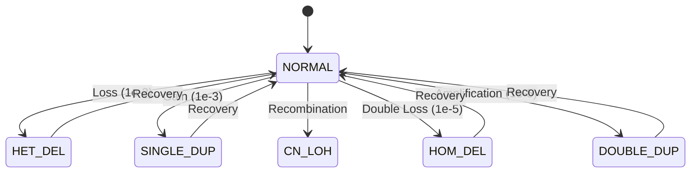
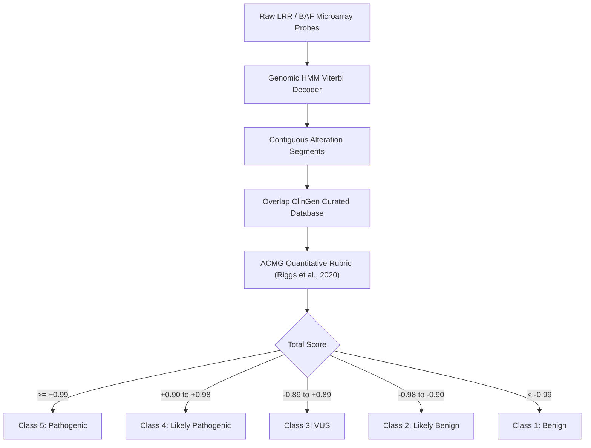

# GenoHMM: Clinical Copy Number Variation (CNV) Detection & ACMG Pathogenicity Scoring

[](https://github.com/ZengLLQ/geno-hmm/actions/workflows/ci.yml)
[](https://python.org)
[](LICENSE)

A high-performance scientific and clinical bioinformatics library for **whole-genome copy number variation (CNV) detection** from high-density SNP microarray intensity signals (Log R Ratio and B-Allele Frequency) coupled with an automated **ACMG/ClinGen quantitative pathogenicity scoring engine** (Riggs et al., 2020).

---

## 1. Clinical & Biological Context

Chromosomal microarray analysis (CMA) remains the primary diagnostic cytogenomic tool for neurodevelopmental disorders, congenital anomalies, dysmorphic syndromes, and cancer genomic profiling. High-density microarrays record two orthogonal biophysical signals for hundreds of thousands of genomic loci:

1. **Log R Ratio ($\text{LRR}$):** Normalized total hybridization fluorescence intensity representing total copy number relative to a diploid reference:
   $$\text{LRR}_i = \log_2 \left(\frac{R_i}{R_{\text{ref}, i}}\right)$$
2. **B-Allele Frequency ($\text{BAF}$):** Allelic contrast ratio between maternal and paternal alleles ($A$ and $B$):
   $$\text{BAF}_i = \frac{I_{B, i}}{I_{A, i} + I_{B, i}}$$

```
                       Genomic Copy Number States
 ┌──────────────┬──────┬────────────┬────────────────────────┬──────────────────┐
 │ State        │ CN   │ Mean LRR   │ BAF Peak Genotypes     │ Clinical Example │
 ├──────────────┼──────┼────────────┼────────────────────────┼──────────────────┤
 │ HOM_DEL (0)  │  0   │   -3.20    │ [Degenerate / Noise]   │ Homozygous null  │
 │ HET_DEL (1)  │  1   │   -0.55    │ A (0.0), B (1.0)       │ 22q11.2 DiGeorge │
 │ NORMAL (2)   │  2   │    0.00    │ AA (0.0), AB (0.5), BB │ Euploid diploid  │
 │ CN_LOH (3)   │  2   │    0.00    │ AA (0.0), BB (1.0)     │ Uniparental dis. │
 │ SINGLE_DUP(4)│  3   │   +0.40    │ AAA, AAB, ABB, BBB     │ 17p12 CMT1A      │
 │ DOUBLE_DUP(5)│  4   │   +0.75    │ AAAA..BBBB (5 clusters)│ ERBB2 / HER2 amp │
 └──────────────┴──────┴────────────┴────────────────────────┴──────────────────┘
```

---

## 2. Mathematical Foundation & Hidden Markov Architecture



### A. Genomic Distance Decay Transition Model
Adjacent microarray probes on a chromosome are separated by physical base-pair distances $d_i = \text{pos}_{i+1} - \text{pos}_i$. The transition probability matrix decays exponentially from the identity matrix towards the stationary prior distribution $\boldsymbol{\pi}$ as a function of characteristic genomic correlation length $D$ ($100\text{ kb}$):

$$T_{s, s'}(d_i) = \delta_{s, s'} e^{-d_i / D} + \pi_{s'} \left(1 - e^{-d_i / D}\right)$$

### B. Joint Continuous Emission Probability Density
The joint log-likelihood of observation $\mathbf{y}_i = (\text{LRR}_i, \text{BAF}_i)$ given latent state $s$ is factorized as:

$$\log P(\mathbf{y}_i \mid S_i = s) = \log \mathcal{N}\left(\text{LRR}_i; \mu_{s}, \sigma_{\text{LRR}, s}^2\right) + \log \left[ (1 - \epsilon_{\text{bg}}) \sum_{k=1}^{K_s} \frac{1}{K_s} \mathcal{N}\left(\text{BAF}_i; \theta_{s, k}, \sigma_{\text{BAF}}^2\right) + \epsilon_{\text{bg}} \right]$$

### C. Log-Space Dynamic Programming (Viterbi Decoding)
To prevent numerical underflow over sequences of $> 100,000$ probes:

$$V_t(s) = \max_{k \in \{0..5\}} \left\{ V_{t-1}(k) + \log T_{k, s}(d_{t-1}) \right\} + \log P(\mathbf{y}_t \mid S_t = s)$$

---

## 3. ACMG / ClinGen Technical Standard Classification

Every segmented alteration is assessed against ClinGen dosage sensitivity curated genes (Haploinsufficiency `HI=3`, Triplosensitivity `TS=3`):



---

## 4. Installation

```bash
git clone https://github.com/ZengLLQ/geno-hmm.git
cd geno-hmm
pip install -e .
```

---

## 5. Command-Line Interface (CLI)

### Run DiGeorge 22q11.2 Microdeletion Demo
```bash
geno-hmm demo --scenario digeorge --noise 0.9
```

Output:
```text
=== Log R Ratio (LRR Intensity Profile) ===
+1.0 |                                                                      |
+0.7 |                                                                      |
+0.3 |                                                                      |
 0.0 |•••••••••••••▼▼▼▼▼▼▼▼▼▼▼▼▼▼▼▼▼▼▼▼▼▼•••••••••••••••••••••••••••••••••••|
-0.3 |             ▼▼▼▼▼▼▼▼▼▼▼▼▼▼▼▼▼▼▼▼▼▼                                   |
-0.7 |             ▼▼▼▼▼▼▼▼▼▼▼▼▼▼▼▼▼▼▼▼▼▼                                   |
-1.0 |                                                                      |
     +----------------------------------------------------------------------+
       18.00 Mb                                                     22.00 Mb

CALL |=============----------------------===================================|
```

### Run Accuracy Benchmark
```bash
geno-hmm benchmark --num-runs 20
```

---

## 6. Python API Example

```python
from geno_hmm import MicroarraySimulator, ViterbiDecoder, ACMGScorer, CNVState

# 1. Simulate microarray probe track
sim = MicroarraySimulator(random_seed=42)
data = sim.generate_chromosome("chr22", 18_000_000, 22_000_000)
data = sim.inject_alteration(data, 19_200_000, 20_500_000, CNVState.HET_DEL)

# 2. Viterbi HMM CNV calling
decoder = ViterbiDecoder()
segments = decoder.call_segments(data.chromosome, data.positions_bp, data.lrr, data.baf)

# 3. Clinical scoring
scorer = ACMGScorer()
for seg in segments:
    report = scorer.classify_segment(seg, is_de_novo=True, phenotype_match=True)
    print(f"Call: {seg.state_name} on {seg.chromosome}:{seg.start_bp}-{seg.end_bp}")
    print(f"Classification: {report.acmg_class.value} (Score: {report.total_score:+.2f})")
```

---

## 7. Testing

```bash
pytest -v
```

---

## 8. Clinical Citations & References

- **Riggs, E. R., et al. (2020).** Technical standards for the interpretation and reporting of constitutional copy-number variants: a joint consensus recommendation of the American College of Medical Genetics and Genomics (ACMG) and the Clinical Genome Resource (ClinGen). *Genetics in Medicine*, 22(2), 245–257.
- **Wang, K., et al. (2007).** PennCNV: an integrated hidden Markov model designed for high-resolution copy number variation detection in whole-genome SNP genotyping data. *Genome Research*, 17(11), 1665–1674.
